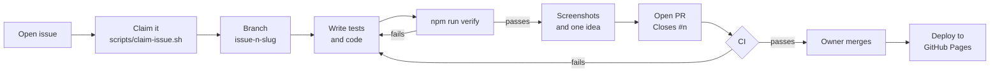
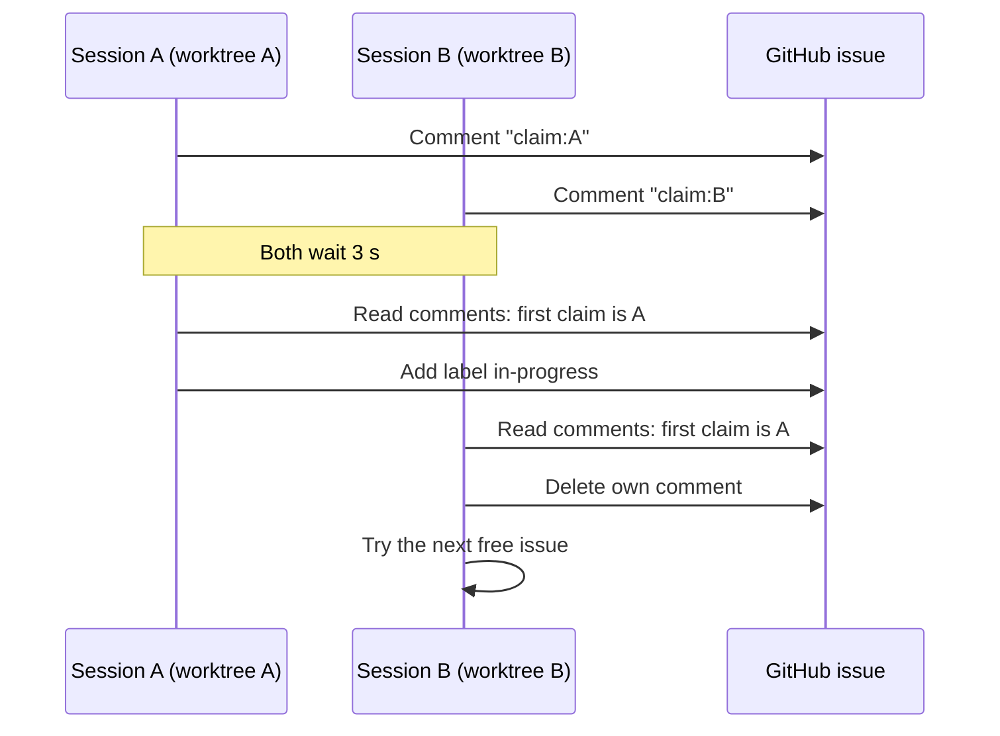
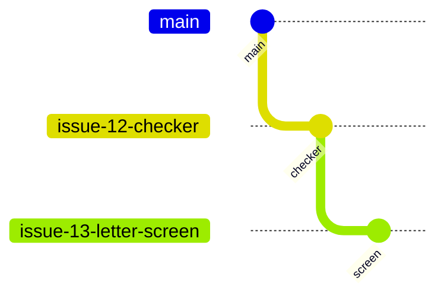

# Contributing

This guide is for humans and for Claude Code agents.
The binding rules are in [CLAUDE.md](CLAUDE.md). This guide explains how to
apply them.

## Contents

1. [Requirements](#requirements)
2. [Install](#install)
3. [Workflow](#workflow)
4. [Rules for every change](#rules-for-every-change)
5. [Tests](#tests)
6. [Screenshots](#screenshots)
7. [Assets and credits](#assets-and-credits)
8. [Ideas](#ideas)
9. [Work with Claude Code](#work-with-claude-code)
10. [Prevent merge conflicts](#prevent-merge-conflicts)
11. [Writing style](#writing-style)
12. [Troubleshooting](#troubleshooting)

## Requirements

| Tool | Version | Why |
|---|---|---|
| Node.js | 24 or later (26 in `.nvmrc`) | Build, tests, scripts |
| Git | 2.40 or later | Worktrees, `rebase --update-refs` |
| GitHub CLI (`gh`) | Recent | Issues, PRs, screenshots, issue claims |
| Playwright browsers | WebKit and Chromium | Browser tests |
| Claude Code | Optional | Agent sessions (`/next-issue`) |

## Install

1. Clone the repo:

   ```sh
   git clone https://github.com/moureauf/kids-games.git
   cd kids-games
   ```

2. Install the packages:

   ```sh
   npm ci
   ```

3. Install the test browsers:

   ```sh
   npx playwright install webkit chromium
   ```

4. Do all the checks. All checks must pass on a clean clone.

   ```sh
   npm run verify
   ```

## Workflow

One issue gives one branch and one pull request (PR).
Only the repo owner merges PRs.



### Issues

- Each issue has a **Scope** and a **Done when** check.
- Each issue has two labels: `game:<name>` and `size:S` or `size:M`.
  Shared work uses `game:hub`.
- Other labels:

| Label | Meaning |
|---|---|
| `in-progress` | A session works on the issue. Do not start it. |
| `needs:owner` | The issue needs the owner (a download, a decision, a test on the real iPad). |
| `blocked` | The issue waits for another issue or PR. |
| `dependencies` | Dependabot update. |

### Branches, commits and PRs

- Make the branch name `issue-<n>-<short-slug>`, for example
  `issue-6-safari-scene`.
- **Do not push to `main`.** Branch protection and a Claude Code hook stop it.
- Write the commit message in the imperative: "Add the hub tiles".
- Put `Closes #<n>` in the PR body.
- Fill in the PR template. It has the checklist.
- The owner uses **squash merge**. The PR title becomes the commit on
  `main`, so make it a short imperative summary.
- CI must pass: the `check` job and the `e2e` job.

## Rules for every change

These rules come from [CLAUDE.md](CLAUDE.md) and
[docs/DESIGN.md](docs/DESIGN.md).

| Area | Rule |
|---|---|
| Teaching | Each game teaches one real skill. |
| Rounds | Each round has a natural end. Do not use timers, streaks, scores or endless rewards. |
| Mistakes | Give a gentle hint. Do not give a penalty or a failure sound. |
| Touch | Make targets 120 CSS px or more in toddler games, 88 px or more for others. |
| Offline | Every game works offline. Add each new game or screen to `tests/e2e/offline.spec.ts`. |
| Privacy | Do not put the children's names, photos or voices in the repo, the issues or the PRs. |
| Assets | Use only CC0 files or original art. Add each file to `CREDITS.md`. |
| Facts | Give each fact an `https` source in its data file. |
| Brands | Do not use brand characters or copy their look. Do not copy RWI material. |

## Tests

| Kind | Tool | Folder | Use it for |
|---|---|---|---|
| Unit | Vitest | `tests/unit/` | Logic: routing, letter geometry, speech queue, guardrails |
| Browser (e2e) | Playwright | `tests/e2e/` | Behaviour on iPad viewports: taps, drags, speech, offline |
| Guardrails | Vitest | `tests/unit/guardrails.test.ts`, `tests/unit/ideas.test.ts` | Credits, fact sources, idea files |

- Write the test first when you can.
- The browser tests use the **production build**, because the service worker
  is only in that build.
- There are two Playwright projects: `ipad-webkit` (close to Safari on the
  iPad) and `ipad-chromium`.
- To check what the app says, use the speech stub in
  `tests/e2e/helpers/speech-stub.ts`.
- Do not skip or weaken a test to make it pass. Find the cause.

## Screenshots

Each PR with a visible change has an iPad screenshot.

1. Tag the screenshot test with `@shot` in its title.
2. Make the screenshots:

   ```sh
   rm -rf screenshots && npm run shots
   ```

3. Look at each image.
4. Upload the images and get the Markdown for the PR:

   ```sh
   scripts/pr-screenshot.sh <issue-number> screenshots/ipad-webkit/<file>.png
   ```

The script puts the images on the `pr-assets` branch, not on `main`.

## Assets and credits

1. Put the file in `public/assets/<folder>/`.
2. Add a row to the correct table in `CREDITS.md`:

   ```markdown
   | `assets/sounds/cow.ogg` | https://freesound.org/... | author | CC0 |
   ```

3. Keep the rows of each table **sorted by file path**. A test checks this.
4. Run `npm test`. The guardrail test fails if a file has no row, if a row
   has no file, or if the licence is not CC0 or Original.

## Ideas

Each session adds one idea for a new game.

1. Make a new file `ideas/<yyyy-mm-dd>-<slug>.md`.
2. Use the format in [IDEAS.md](IDEAS.md).
3. Do not edit other idea files.

## Work with Claude Code

### One session

1. Start Claude Code in the repo:

   ```sh
   claude --worktree
   ```

2. Type `/next-issue` to take the oldest free issue, or `/next-issue 12` for
   issue 12.

The skill in `.claude/skills/next-issue/SKILL.md` does the full workflow and
opens a PR. It does not merge.

### Parallel sessions

You can start many sessions at the same time. Each session has its own
worktree, its own test port and its own issue.



| Risk | Protection |
|---|---|
| Two sessions change the same files | Each session uses its own git worktree (`claude --worktree`). |
| Tests use the build of another session | Each worktree has its own port. Playwright does not use a server that it did not start. |
| Two sessions take the same issue | `scripts/claim-issue.sh`: the first claim comment wins. |
| Two sessions upload screenshots together | `scripts/pr-screenshot.sh` tries the push again. |

### Orchestrator with subagents

One Claude Code session can start subagents. Each subagent does one issue in
its own worktree. The orchestrator:

1. Selects issues that do not depend on each other.
2. Gives each subagent its issue, the files that it owns, and the shared
   interfaces.
3. Checks each PR: CI, the diff, the screenshots and privacy.
4. Tells the owner which PRs are ready to merge.

### Claude Code configuration

| File | What it does |
|---|---|
| `CLAUDE.md` | Rules that every session reads first. |
| `.claude/settings.json` | Allows usual commands. Stops edits outside the repo, `gh pr merge` and pushes to `main`. |
| `.claude/hooks/format.sh` | Formats each edited file with Biome. |
| `.claude/hooks/guard-main.sh` | Stops `git push` to `main`, and stops any push while `main` is checked out. |
| `.claude/skills/next-issue/` | The `/next-issue` workflow. |
| `.claude/agents/reviewer.md` | The reviewer subagent. It posts a verdict comment that starts with `<!-- review-verdict sha=<head> verdict=<approve\|changes\|owner-check> -->`. |
| `.claude/settings.local.json` | Your own settings. Git ignores this file. |

## Prevent merge conflicts

Conflicts occur when two PRs change the same lines. The repo removes the
usual causes:

| Hot spot | Solution |
|---|---|
| Ideas | One file for each idea in `ideas/`. |
| Credits | Rows sorted by path, so new rows go to different lines. |
| Games list and offline test | Planned: find games automatically ([#39](https://github.com/moureauf/kids-games/issues/39)). |

### Stacked PRs

Use a stack only when a PR needs code from a PR that is not merged.
For example, the letter screen needs the tracing checker.



1. Make the second branch from the first branch:

   ```sh
   git switch -c issue-13-letter-screen issue-12-checker
   ```

2. Open the second PR with the first branch as its base:

   ```sh
   gh pr create --base issue-12-checker
   ```

3. Write "Stacked on #12" in the PR body.
4. When the first branch changes, update the stack in one command:

   ```sh
   git switch issue-13-letter-screen
   git rebase --update-refs issue-12-checker
   git push --force-with-lease origin issue-12-checker issue-13-letter-screen
   ```

5. When the owner merges the first PR, GitHub deletes its branch and changes
   the base of the second PR to `main`.
6. The squash merge puts the first PR on `main` as one new commit. The second
   branch still has the old commits, so the second PR now shows conflicts.
   Move only the commits of the second branch onto `main`:

   ```sh
   git fetch origin
   git rebase --onto origin/main issue-12-checker issue-13-letter-screen
   git push --force-with-lease origin issue-13-letter-screen
   ```

   Here `issue-12-checker` is your local copy of the first branch. Do not
   delete it before this step.

## Writing style

All documents use **ASD-STE100 Simplified Technical English**.

| Rule | Example |
|---|---|
| Write procedures as numbered steps, one instruction in each step. | "1. Install the packages." |
| Use the imperative in procedures. | "Run `npm test`." |
| Use the active voice. | "The test checks the file." Not "The file is checked." |
| Keep procedure sentences to 20 words or fewer, descriptive sentences to 25 or fewer. | |
| Keep paragraphs to 6 sentences or fewer. | |
| Use one word for one meaning. Use simple, common words. | "start", not "kick off" |
| Use tables, lists and diagrams when they make the text shorter. | |
| Write warnings before the step that they apply to. | "**Do not push to `main`.**" |

Commands, file names and code names stay as they are.

## Troubleshooting

| Problem | Cause | Solution |
|---|---|---|
| `npm run e2e` says the port is in use | A server from an earlier run still runs on the port of this worktree. | Stop that server, or set `PORT=<free port>`. |
| The page shows an old version | The service worker serves the old cache. The new version loads when the hub shows (`src/core/update.ts`). Pages from before [#46](https://github.com/moureauf/kids-games/issues/46) do not have this code. | Go to the hub, or reload one time. If the old version stays, clear the site data in the browser. |
| Playwright says a browser is missing | The browsers are not installed. | Run `npx playwright install webkit chromium`. |
| CI says the image does not match `@playwright/test` | A dependency update changed the Playwright version. | Change `container.image` and `PLAYWRIGHT_IMAGE_VERSION` in `.github/workflows/ci.yml`. |
| A push is blocked by `guard-main.sh` | The command pushes to `main`, or the session is on `main`. | Push from your `issue-<n>-…` branch. |
| `claim-issue.sh` says the issue is claimed | Another session has the issue. | Run it with no number to get the next free issue. |
