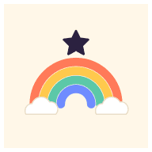
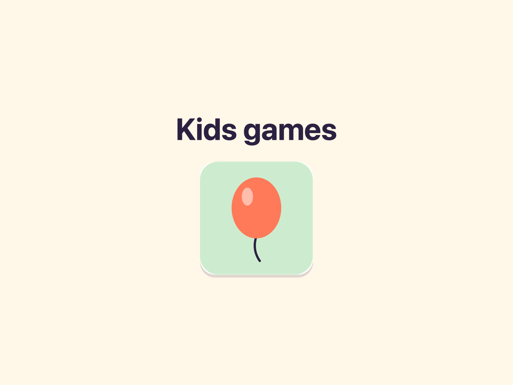
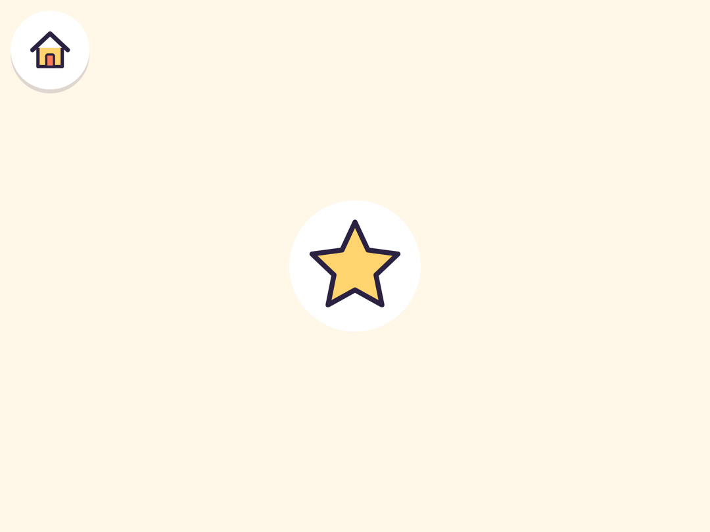
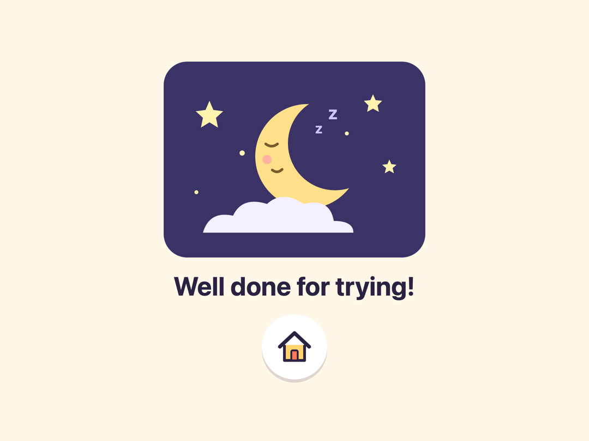

# kids-games



Small browser games that teach young children real skills.
The games are for the iPad first. They work offline after the first visit.

[](https://github.com/moureauf/kids-games/actions/workflows/ci.yml)
[](https://github.com/moureauf/kids-games/actions/workflows/deploy.yml)
[](LICENSE)

**Play:** <https://francoismoureau.com/kids-games/>

| Hub | In a game | End of a round |
|---|---|---|
|  |  |  |

## What it is

- **Teach, do not hook.** Each game trains one skill: phonics, letter
  formation, counting, vocabulary, French or facts.
- **A natural end.** A round takes 5 to 10 minutes. Then the game stops
  calmly. There are no timers, streaks, scores, ads or accounts.
- **Praise the effort.** A wrong answer gets a gentle hint, not a penalty.
- **Private.** The site does not collect data. It does not use the network
  after it loads.
- **Original art and CC0 sounds.** See [CREDITS.md](CREDITS.md).

## Games

| Game | For | Skill | Status |
|---|---|---|---|
| **Sound safari:** tap an animal, a vehicle or a dinosaur. It moves, makes its sound, and a voice says its name. | Toddlers | Vocabulary, cause and effect | First scene playable |
| **Unicorn letter trail:** trace a letter with a finger. The unicorn leaves a rainbow on the path. | Pre-schoolers | Letter formation | Letter data done |

More games and their plans are in [docs/GAMES.md](docs/GAMES.md).

## Play on the iPad

1. Open <https://francoismoureau.com/kids-games/> in Safari.
2. Tap **Share**, then tap **Add to Home Screen**.
3. Open the app from the Home Screen one time while the iPad is online.

After step 3, the games work with no network.
A new version loads at the next visit with network.

## Quick start for developers

You need [Node.js](https://nodejs.org/) 24 or later (the repo uses 26, see
`.nvmrc`) and Git.

```sh
git clone https://github.com/moureauf/kids-games.git
cd kids-games
npm ci
npx playwright install webkit chromium
npm run dev
```

Open the address that `npm run dev` shows.
The dev server does not use the service worker.

Before you open a pull request, do all the checks:

```sh
npm run verify
```

## Commands

| Command | What it does |
|---|---|
| `npm run dev` | Starts the dev server with hot reload. No service worker. |
| `npm run build` | Does a type check and makes the production build in `dist/`. |
| `npm run preview` | Serves `dist/` at <http://localhost:4173/kids-games/>. |
| `npm run lint` | Checks format and lint rules (Biome). |
| `npm run format` | Fixes format and safe lint problems. |
| `npm run typecheck` | Checks the TypeScript types. |
| `npm test` | Runs the unit tests (Vitest). |
| `npm run e2e` | Runs the browser tests on iPad viewports (Playwright). |
| `npm run shots` | Makes iPad screenshots of the tests tagged `@shot`. |
| `npm run verify` | Runs lint, types, unit tests and browser tests. |
| `npm run ideas` | Shows all game ideas in one table. |
| `npm run icons` | Makes the PNG icons from `public/assets/icons/icon.svg`. |

## Documentation

| Document | Read it to |
|---|---|
| [CONTRIBUTING.md](CONTRIBUTING.md) | Install, test and send changes. Work with Claude Code sessions. |
| [docs/ARCHITECTURE.md](docs/ARCHITECTURE.md) | Understand the code, the offline cache, the tests and CI. |
| [docs/DESIGN.md](docs/DESIGN.md) | Learn the design rules and the visual style. |
| [docs/GAMES.md](docs/GAMES.md) | See each game, its skill, its status and its plan. |
| [CLAUDE.md](CLAUDE.md) | Rules for every Claude Code session. They also apply to humans. |
| [IDEAS.md](IDEAS.md) | Add and review ideas for new games. |
| [CREDITS.md](CREDITS.md) | See the source and licence of each asset. |
| [SECURITY.md](SECURITY.md) | Report a security or privacy problem. |

## Licence

The code and the original art are under the [MIT licence](LICENSE).
Third-party sounds are CC0. Each one is in [CREDITS.md](CREDITS.md).
