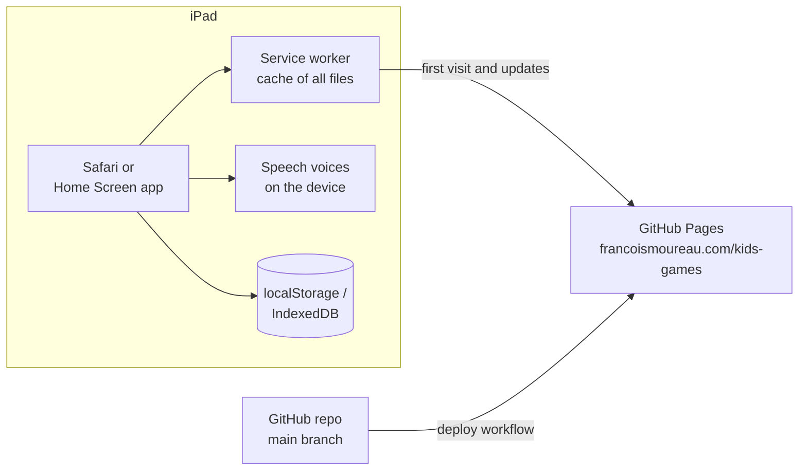
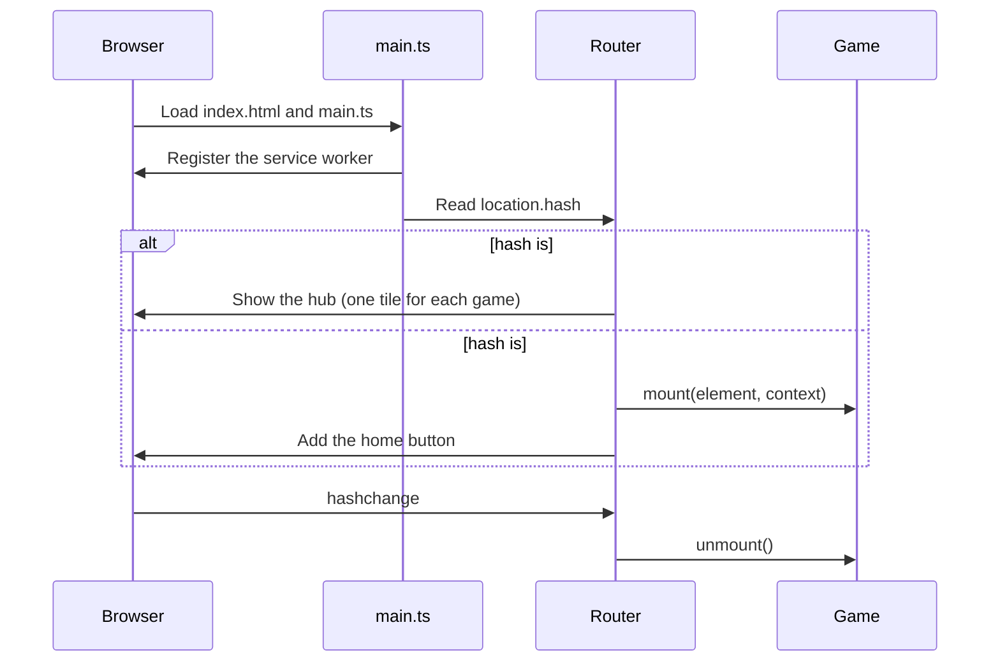
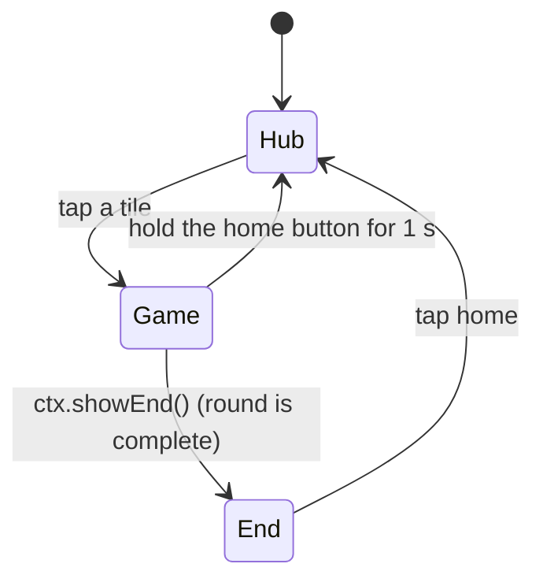
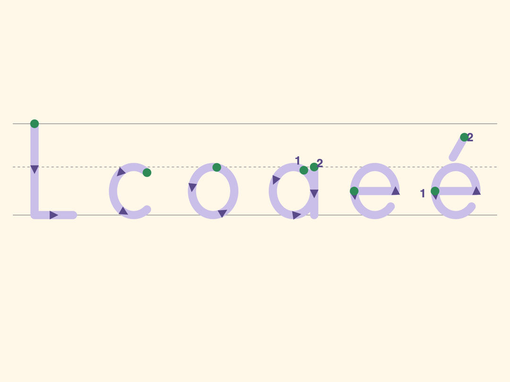
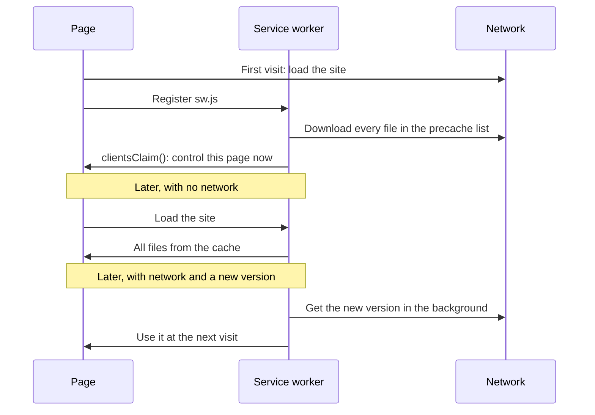
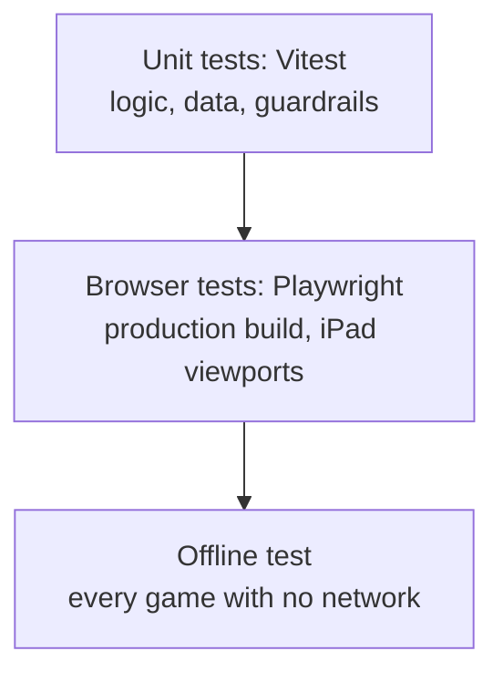
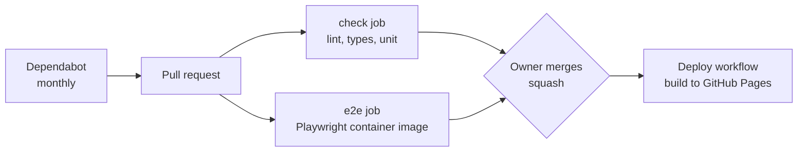

# Architecture

This document describes how the code works. For the design rules, read
[DESIGN.md](DESIGN.md). For the workflow, read
[CONTRIBUTING.md](../CONTRIBUTING.md).

## Summary

| Part | Choice | Why |
|---|---|---|
| Language | TypeScript, strict mode | Types catch errors before the iPad does. |
| Build | Vite | Fast, simple, static output. |
| UI | Plain DOM and inline SVG. No framework. | The games are small. SVG gives sharp art and large touch targets. |
| Routing | URL hash: `#/` and `#/<game-id>` | Works on GitHub Pages and offline with no server rules. |
| Offline | PWA with a Workbox service worker (`vite-plugin-pwa`) | The games work in the car, on a plane, on holiday. |
| Voice | Web Speech API (`en-GB`, `fr-FR`) | The iPad has the voices on the device. |
| Sound | Web Audio API: CC0 files and sounds made by code | No network. Volume has a limit. |
| Lint and format | Biome | One fast tool. |
| Tests | Vitest (unit), Playwright (browser, iPad viewports) | |
| Hosting | GitHub Pages | Free, static, HTTPS. |
| Backend | None | No accounts, no tracking, no data leaves the device. |

## System context



After the first visit, the app gets all files from the service worker cache.
It does not use the network for anything else.

## Folder layout

```text
index.html                  Entry page, iPad meta tags
src/
  main.ts                   Starts the app and the router
  style.css                 Shared styles
  core/
    game.ts                 Game and GameContext interfaces
    router.ts               Route parsing (pure functions)
    speech.ts               say(), sayAll(), voice choice
    audio.ts                playFile(), playTone(), volume limit
    ui/
      hub.ts                Game tiles
      home-button.ts        Hold-to-go-home button
      end-screen.ts         End of round screen
  games/
    index.ts                Registry: the list of games
    test-game.ts            Test game, only with ?e2e in the URL
    letter-trail/           Letter stroke data and geometry
public/
  assets/                   Icons, sounds (each one in CREDITS.md)
ideas/                      One file for each game idea
scripts/                    Repo tools (claims, screenshots, ideas)
tests/
  unit/                     Vitest
  e2e/                      Playwright
docs/                       This documentation
.claude/                    Claude Code settings, hooks, skills
.github/                    CI, deploy, Dependabot, templates
```

## Start-up and routing



- An unknown route goes to the hub, and the address changes to `#/`.
- The router always unmounts the old game before it shows the next screen.
- The router adds the home button. Games do not add their own.

## The game contract

Each game is a module that implements `Game` from `src/core/game.ts`:

```ts
export interface Game {
	id: string; // route id, e.g. "sound-safari" → #/sound-safari
	title: string; // for aria-label only; the child does not read
	tile: string; // inline SVG for the hub tile (original art)
	mount(el: HTMLElement, ctx: GameContext): void;
	unmount(): void;
}

export interface GameContext {
	goHome(): void;
	showEnd(): void; // shows the shared end screen and unmounts the game
}
```



Rules for a game:

1. Draw only inside the element `el`.
2. Count the round in items or taps, not in time.
3. Call `ctx.showEnd()` when the round is complete.
4. In `unmount()`, stop all sounds, timers and listeners that the game started.
5. Add the game to `src/games/index.ts` and to `tests/e2e/offline.spec.ts`.
   (Issue [#39](https://github.com/moureauf/kids-games/issues/39) will make
   this step automatic.)

## Core modules

| Module | Main exports | Notes |
|---|---|---|
| `core/speech.ts` | `say(text, lang)`, `sayAll(items)`, `cancelSpeech()`, `unlockSpeech()`, `pickVoice()` | Prefers `en-GB` and `fr-FR`. Waits up to 1.5 s for the voices to load. Never throws. With no voice for a language, it stays silent. A watchdog resolves the promise if the browser does not send the end event. |
| `core/audio.ts` | `unlockAudio()`, `playFile(url)`, `playTone(spec)`, `MAX_VOLUME` | Call `unlockAudio()` on the first tap (iPad rule). Volume limit 0.5. Tones fade in and out. `duration` is in milliseconds. |
| `core/router.ts` | Route parsing | Pure functions with unit tests. |
| `core/ui/home-button.ts` | Home button | 120 px. Works only after a 1 s hold. A ring fills during the hold. |
| `core/ui/end-screen.ts` | End screen | A sleeping moon and "Well done for trying!". No automatic restart. |

## Letter data

`src/games/letter-trail/letters.ts` holds the stroke data for each letter.
`geometry.ts` holds `arc()`, `pathLength()` and `pointAt()`.



| Item | Value |
|---|---|
| Units | x-height = 1 |
| Origin | Top left of the letter box. y goes down (as in SVG). |
| Cap line | y = 0 |
| x-height line | y = 0.9 |
| Baseline | y = `BASELINE` = 1.9 |
| Descent | 0.9 below the baseline (for g, p, y), so `BOX_HEIGHT` = 2.8 |
| Strokes | In writing order. Each stroke starts at its start dot. |

## Offline (PWA)



- The configuration is in `vite.config.ts`.
- The precache list has every built file and every file in `public/assets/`.
- `registerType: "autoUpdate"`: the child never sees an update prompt.

> **Caution:** Do not put a file two times in the precache list (for
> example with `includeAssets` and the glob). Workbox then stops the install
> without an error and caches nothing. The offline test finds this problem.

## Data on the device

| Data | Storage | Leaves the device? |
|---|---|---|
| Settings: French on or off (planned, [#4](https://github.com/moureauf/kids-games/issues/4)) | `localStorage` | No |
| A child's name for "My name" mode (planned) | `localStorage` | No |
| Parent recordings of pure sounds (planned) | IndexedDB | No. Export to a file only by hand. |

## Tests



- Playwright starts `vite preview` on a port made from the worktree path, or
  on `PORT`. It never uses a server that it did not start. Parallel sessions
  thus do not test the build of another session.
- Projects: `ipad-webkit` and `ipad-chromium`, both iPad (gen 7) landscape.
- `tests/e2e/helpers/speech-stub.ts` records each utterance in
  `window.__spoken`.

## CI and deploy



- `.github/workflows/ci.yml`: the `check` job and the `e2e` job. Both are
  required by branch protection.
- The `e2e` job runs in `mcr.microsoft.com/playwright:v<version>-noble`.
  The image has the browsers, so CI does not use apt. A step fails if the
  image version and `@playwright/test` are different.
- `.github/workflows/deploy.yml`: builds and deploys to GitHub Pages on each
  push to `main`.
- Repo settings: squash merge only, branches deleted after merge, secret
  scanning and push protection on.

## Decisions

| Decision | Reason | Alternative not used |
|---|---|---|
| No UI framework | Small games, small bundle, fewer updates | React, Svelte |
| Hash routing | No server rules on GitHub Pages, simple offline | History API with a 404 fallback |
| Workbox `generateSW` | All files precached with no custom code | A hand-written service worker |
| Playwright container in CI | No apt mirror stalls | `playwright install-deps` on each run |
| One file for each idea | No merge conflicts between parallel PRs | One shared table |
| Claim comments on issues | Parallel sessions never take the same issue | A label only (two sessions can add it at the same time) |
