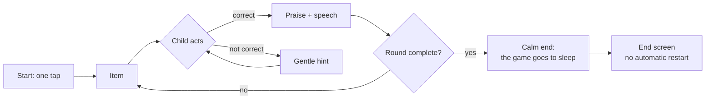
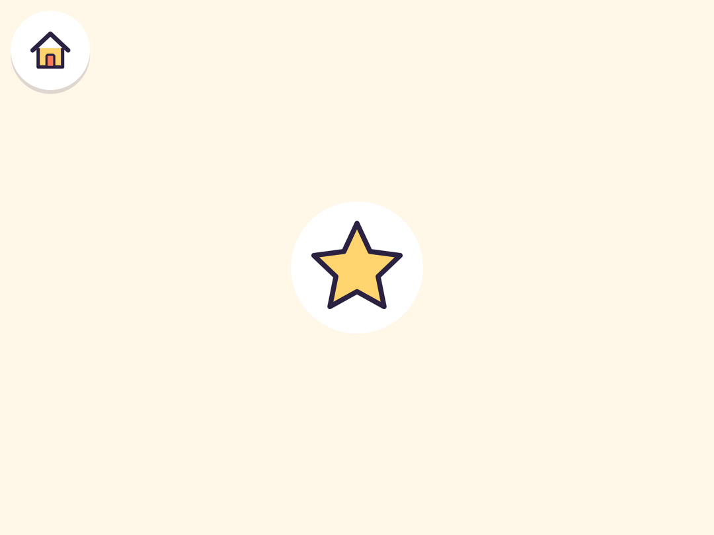
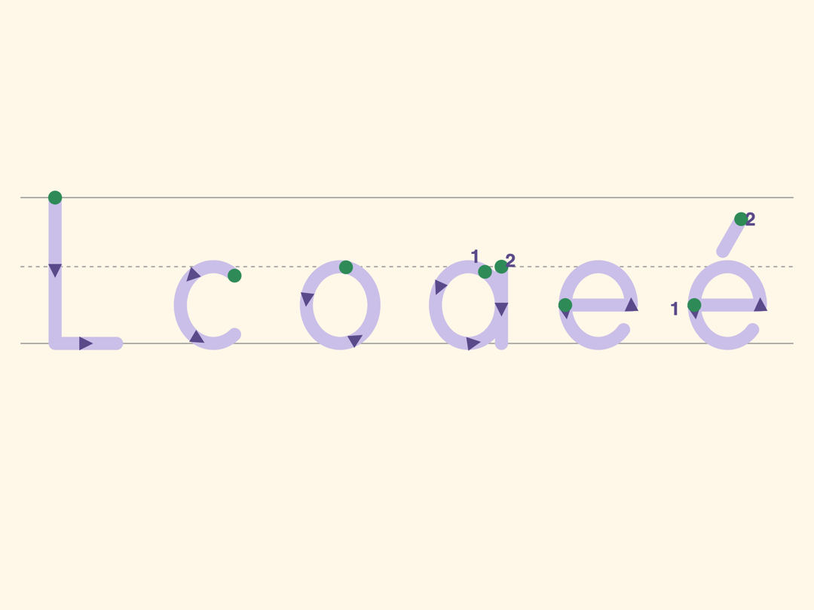
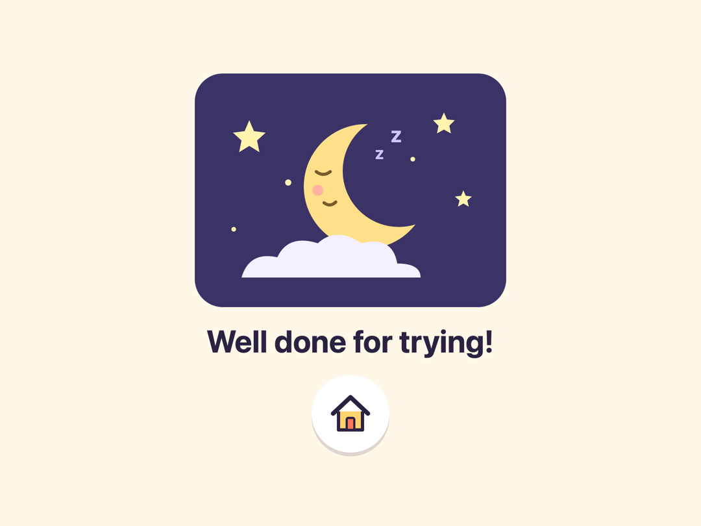

# Design

This document explains the design rules of kids-games and the visual style.
[CLAUDE.md](../CLAUDE.md) has the short, binding version of the rules.

## Players

| Player | Age | Likes | Needs |
|---|---|---|---|
| Pre-schooler | About 3 to 5 | Unicorns, fairies, princesses, magic creatures to collect, silly inventions | Phonics, print letter formation, numbers to 10 and then 20 |
| Toddler | About 1 to 3 | Animals, vehicles, dinosaurs and their sounds | Cause and effect, large targets, no failure states |
| Parent | Adult | | Settings behind a gate, a clear end to each round |

> **Privacy:** Do not write personal details of the players in the repo:
> no names, ages, schools, photos or voices. Data that a parent enters on the iPad stays on
> the iPad.

## Principles

| # | Principle | What it means in a game | How we check it |
|---|---|---|---|
| 1 | **Teach, do not hook** | Each game trains one real skill. No streaks, loot boxes, timers, endless rewards, ads, tracking or accounts. | Review. No network calls in the code. |
| 2 | **A natural end** | A round is 5 to 10 minutes, counted in items or taps. Then the game stops calmly: the fairy sleeps, the bus goes home. | e2e test reaches the end screen. |
| 3 | **Praise the effort** | A wrong answer gets a gentle hint. No penalty, no buzzer, no lost points, no score. | e2e tests for hints. |
| 4 | **Match UK phonics teaching** | Print letters with a start dot and the correct stroke order. Pure sounds ("mmm", not "muh"). Numbers follow the EYFS goals. | Unit tests on letter data. |
| 5 | **Two languages** | English first. A setting adds French words, with the article ("la vache"). | e2e test of EN, then FR. |
| 6 | **Correct facts only** | Each fact has an `https` source in its data file. | Guardrail unit test. |
| 7 | **Original art** | Themes that the children like, but no brand characters and no copies of their look. | Review. `CREDITS.md` and its test. |
| 8 | **Works offline** | Every game works with no network after the first visit. | Offline e2e test. |

## The shape of a round

Every game follows this pattern:

### Hints

A hint gets more helpful each time. It never gets louder or more negative.

| Try | Hint | Example (letter trail) |
|---|---|---|
| 1 | Show where to look | The start dot pulses. |
| 2 | Show the way | The path glows and an arrow moves along it. |
| 3 | Do it together, then praise | The unicorn shows the stroke, says "Good trying!", and the game moves on. |

## Visual style

### Colours

| Name | Hex | Use |
|---|---|---|
| Cream | `#fff7e8` | Page background |
| Ink | `#2b2140` | Text, outlines |
| Coral | `#ff7a59` | Accent, main actions |
| Sun | `#ffc94d` | Stars, rewards, highlights |
| Mint | `#5cc8a8` | Nature, success |
| Sky | `#6f8cff` | Water, calm areas |
| Night | `#3b3366` | End screen sky |
| White | `#ffffff` | Buttons, tiles |

Keep the contrast of text and outlines on their background at 4.5:1 or
more.

### Shapes and type

- Use round corners and thick, soft outlines. Do not use sharp edges.
- Use the system font (`system-ui`). The child does not need to read, so text
  is only for adults and for labels.
- Draw all art as inline SVG in the repo. SVG stays sharp on the iPad screen.

### Touch

| Item | Minimum size |
|---|---|
| Targets in games for toddlers | 120 CSS px |
| Other targets | 88 CSS px |
| Home button | 120 CSS px, 1 s hold to go home |
| Gap between targets | 24 CSS px |

- Do not use double taps, long presses for play, or small buttons.
- A drag must accept a finger that is not precise. The letter checker uses a
  generous tolerance.

### Motion

- Use slow, soft motion: bounce, wiggle, drive away.
- Do not flash. Do not use more than 3 changes each second.
- Respect `prefers-reduced-motion`: show the end state with no animation.

### Sound and voice

- Keep sounds soft. The audio module limits the volume to 0.5.
- Do not use failure sounds.
- The voice is `en-GB`. French words use `fr-FR`. If a voice is not on the
  device, the game stays silent for that language.
- Say the name of a thing after its sound: "moo… cow… la vache".

## Letters and sounds

- Letters are print letters, in the Read Write Inc. (RWI) Set 1 order:
  m a s d t i n p g o c k u b f e l h r j v y w z q x.
- Each letter has a start dot, a stroke order and a direction.
- The formation phrases are our own. **Do not copy RWI phrases, characters,
  pictures or audio.** They are © Oxford University Press.
- Pure sounds come from recordings that a parent makes on the iPad. They stay
  on the device. Text-to-speech cannot say pure sounds well.

## Numbers

- First numbers to 10, then to 20, as in the EYFS goals.
- Count real things on the screen: petals, cakes, coins.
- Say each number when the child taps the thing.

## Checklist for a new game

1. The game teaches one skill from the list in principle 1.
2. A round has a natural end in 5 to 10 minutes.
3. There is no score, timer, streak or failure sound.
4. Wrong answers get hints from the hint table.
5. Targets have the minimum size.
6. The art is original SVG. Each asset file is in `CREDITS.md`.
7. Each fact has an `https` source.
8. English works. French works when the setting is on.
9. The offline test plays the game.
10. [docs/GAMES.md](GAMES.md) has an entry and a screenshot.

