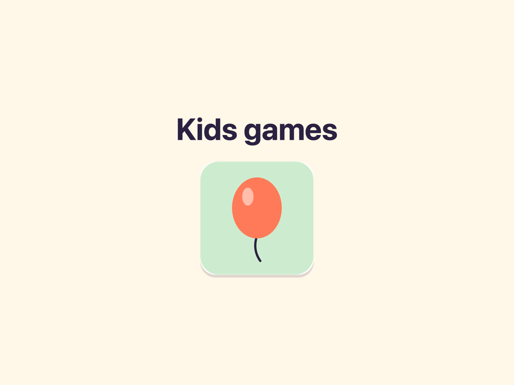
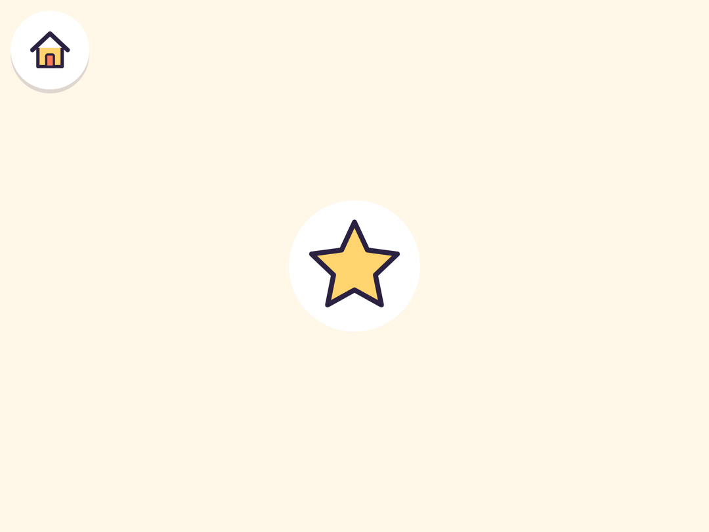
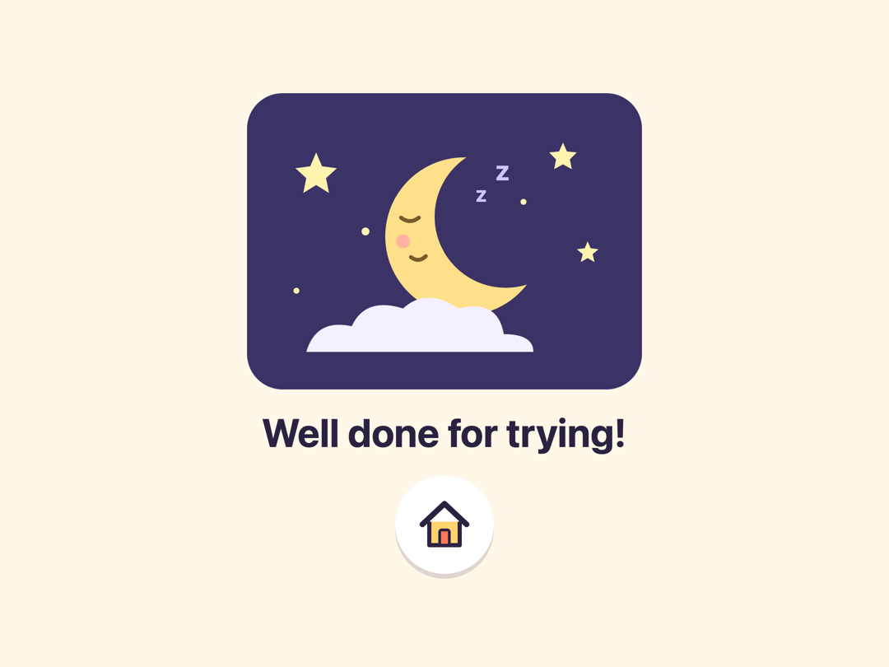
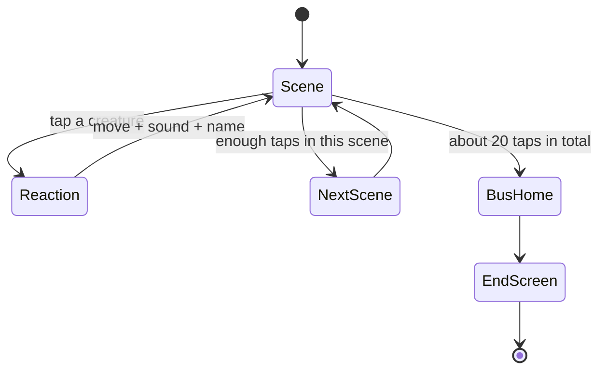
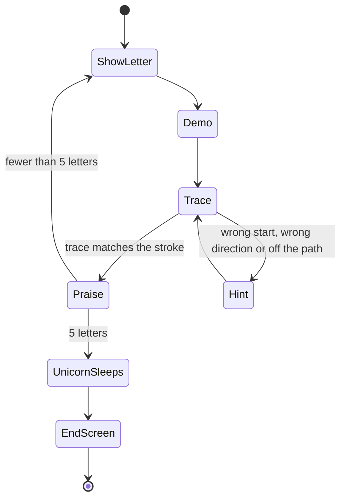
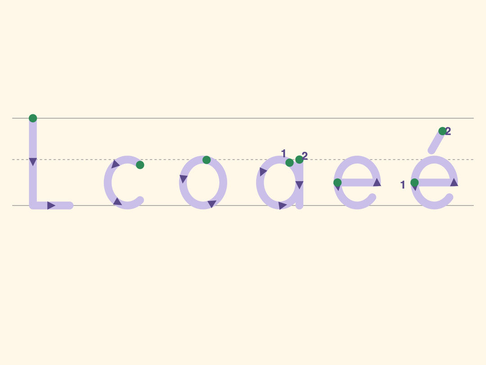

# Games

This catalogue shows each game: who it is for, the skill it teaches, how it
plays, how a round ends, and its status.
To add an idea for a new game, read [IDEAS.md](../IDEAS.md).

## Overview

| # | Game | For | Skill | Status |
|---|---|---|---|---|
| 1 | [Sound safari](#1-sound-safari) | Younger child | Vocabulary, cause and effect | In progress: first scene in review ([#42](https://github.com/moureauf/kids-games/pull/42)) |
| 2 | [Unicorn letter trail](#2-unicorn-letter-trail) | Older child | Letter formation | In progress: letter data done, tracing checker in review ([#43](https://github.com/moureauf/kids-games/pull/43)) |
| 3 | Fairy garden | Older child | Counting, first sounds | Idea |
| 4 | Dino dig | Both | Facts, vocabulary | Idea |
| 5 | Silly inventions | Older child | Sequencing, logic | Idea |
| 6 | Royal tea party | Older child | Counting, sharing | Idea |
| 7 | Printables | Older child | Writing practice on paper | Idea |

Status values: **Idea** (no issues yet), **Planned** (issues exist),
**In progress** (some PRs merged), **Playable** (on the site),
**Complete** (all issues closed).

## Shared screens

All games use the same hub, home button and end screen.

| Hub | Home button in a game | End screen |
|---|---|---|
|  |  |  |
| One large picture tile for each game. The child does not need to read. | Hold the button for 1 s to go home. A ring fills during the hold. A short tap does nothing. | Shows at the end of each round. Tap home to leave. The game does not start again by itself. |

> The hub image shows the test tile. The real game tiles come with the games.

## 1. Sound safari

| Item | Value |
|---|---|
| For | The younger child (almost 2) |
| Skill | Vocabulary, cause and effect |
| Languages | English name, then the French name with its article when French is on |
| Round | About 20 taps, in three scenes: farm, road, dino valley |
| End | The safari bus drives in, everyone waves, and the bus goes home |
| Failure states | None. Every tap is a good tap. |

### How it plays

1. The child taps an animal, a vehicle or a dinosaur.
2. It moves (bounce, wiggle, drive).
3. It makes its sound: CC0 recordings for animals, sounds made by code for
   vehicles and dinosaurs.
4. A voice says its name: "cow", then "la vache".
5. After about 20 taps, the bus takes everyone home.

### Screenshot

The first scene comes with [#6](https://github.com/moureauf/kids-games/issues/6).

### Plan

| Issue | Work | Status |
|---|---|---|
| [#6](https://github.com/moureauf/kids-games/issues/6) | Scene with 6 creatures, English name | In review: [#42](https://github.com/moureauf/kids-games/pull/42) |
| [#7](https://github.com/moureauf/kids-games/issues/7) | Sounds (CC0 animals, code-made vehicles and dinosaurs) | Needs the owner: CC0 downloads |
| [#8](https://github.com/moureauf/kids-games/issues/8) | French name after the English name | Open |
| [#9](https://github.com/moureauf/kids-games/issues/9) | Natural end: the bus goes home | Open |
| [#10](https://github.com/moureauf/kids-games/issues/10) | Three scenes | Open |

## 2. Unicorn letter trail

| Item | Value |
|---|---|
| For | The older child (4) |
| Skill | Print letter formation: start dot, stroke order, direction |
| Languages | English. French letter names and words when French is on. |
| Round | 5 letters, in RWI Set 1 order. The next round continues from the last letter. |
| End | The unicorn curls up and sleeps |
| Mistakes | Gentle hints: the start dot pulses, the path glows. After 3 tries, praise and move on. |

### How it plays

1. The game shows a big grey letter with guide lines and a pulsing start dot.
2. A short demo shows the stroke.
3. The child traces the letter with a finger.
4. An original unicorn follows the finger and leaves a rainbow on the path.
5. The game says our own formation phrase, and the pure sound if a parent
   recorded it.
6. After 5 letters, the unicorn goes to sleep.

### Letter data (done)

The data and its coordinate system are in
[ARCHITECTURE.md](ARCHITECTURE.md#letter-data).

### Plan

| Issue | Work | Status |
|---|---|---|
| [#11](https://github.com/moureauf/kids-games/issues/11) | Stroke data for L c o a e é | Done |
| [#12](https://github.com/moureauf/kids-games/issues/12) | Tracing checker | In review: [#43](https://github.com/moureauf/kids-games/pull/43) |
| [#13](https://github.com/moureauf/kids-games/issues/13) | Letter screen with unicorn and rainbow | Open, needs #12 |
| [#14](https://github.com/moureauf/kids-games/issues/14) | Gentle hints | Open |
| [#15](https://github.com/moureauf/kids-games/issues/15) | Round of 5 letters, then the unicorn sleeps | Open |
| [#16](https://github.com/moureauf/kids-games/issues/16) | Our own formation phrases | Open |
| [#17](https://github.com/moureauf/kids-games/issues/17) | Lowercase m a s d t i n p g k | Open |
| [#18](https://github.com/moureauf/kids-games/issues/18) | Lowercase u b f l h r j v y w z q x | Open |
| [#19](https://github.com/moureauf/kids-games/issues/19) | Capitals A–Z | Open |
| [#20](https://github.com/moureauf/kids-games/issues/20) | Accents é è ê ë à ç | Open |
| [#21](https://github.com/moureauf/kids-games/issues/21) | "My name" mode | Open |
| [#22](https://github.com/moureauf/kids-games/issues/22) | Parent records pure sounds on the device | Open |

## 3–7. Games from the brief

These games have no issues yet. Each one will get a section like the ones
above when its first issues exist.

| Game | Idea |
|---|---|
| Fairy garden | Collect original magic creatures. To find one, count petals or find the first sound ("which name starts with /s/?"). |
| Dino dig | Dig a fossil, build the skeleton, learn one true fact with a source. |
| Silly inventions | Put the steps of a contraption in the correct order, then watch it work. |
| Royal tea party | Share cakes equally between guests. Count coins in the shop. |
| Printables | Themed A4 sheets to print: unicorn tracing words, dinosaur counting. |

## Keep this file correct

When a PR changes a game in a way that you can see:

1. Update the status in the overview table and in the plan table.
2. Add or replace the screenshot in `docs/images/` (1080 px wide).
3. Keep the "How it plays" steps true to the game.
